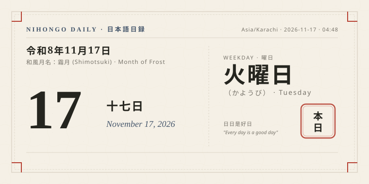
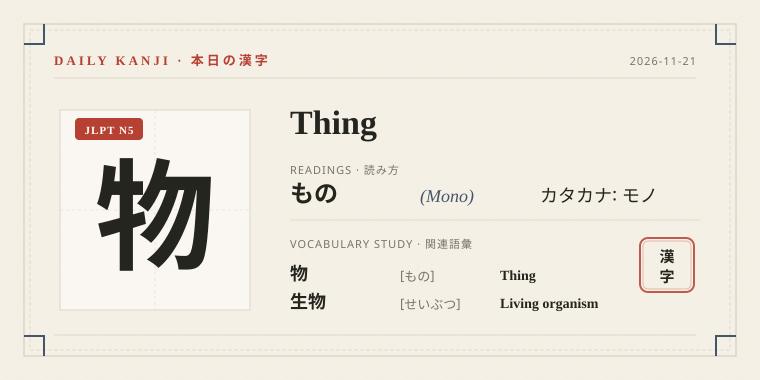

# nihongo-daily 🇯🇵

> An automated Japanese-inspired daily calendar, Kanji flashcard, vocabulary study, and learning journal. Updated every single day through GitHub Actions in `Asia/Karachi` time.

[](https://github.com/mussab/nihongo-daily/actions/workflows/daily.yml)
[](index.html)
[](https://time.is/Karachi)
[](kanji.md)

---

## 📅 Today's Date · 本日の日付

<div align="center">
  
</div>

| Attribute | Details |
| :--- | :--- |
| **Gregorian Date** | November 14, 2026 (`2026-11-14`) |
| **Japanese Date** | 2026年11月14日 |
| **Reiwa Era** | 令和8年11月14日 (令和八年 十一月十四日) |
| **Weekday** | 土曜日（どようび · Saturday） |
| **Traditional Month** | 霜月（Shimotsuki — Month of Frost） |

---

## 🈁 Daily Kanji · 本日の漢字

<div align="center">
  
</div>

### 見 — See / Look

- **JLPT Level:** `N5` (Cycle Day 39 of 93)
- **Reading:** `みる (Miru)`
- **Hiragana:** `みる`
- **Katakana:** `ミル`
- **Romaji:** *Miru*

#### 📖 Related Vocabulary &amp; Studied Forms
- **見る** (`みる` / *Miru*): To see
- **見せる** (`みせる` / *Miseru*): To show
- **い見** (`いけん` / *Iken*): Opinion
- **見学** (`けんがく` / *Kengaku*): Field trip

---

## 📊 Learning Statistics

- **Total Days Recorded:** `1`
- **Unique Kanji Studied:** `1`
- **Total Kanji Collection:** `93` (Foundation N5 Collection)
- **Timezone Anchor:** `Asia/Karachi`

---

## 🏛️ Authentic Japanese Editorial Design

The website and vector graphics are designed with a traditional Japanese stationery and editorial aesthetic:
- **Washi Paper Palette:** Warm washi ecru (`#F5F0E6`), sumi black ink (`#25251F`), cinnabar vermilion stamp red (`#B64032`), and indigo iron (`#45566B`).
- **Typography:** `Noto Serif JP`, `Noto Sans JP`, and `Cormorant Garamond`.
- **Hanko Stamps:** Authentic Japanese cinnabar seal stamps for daily authenticity.
- **Interactive Calendar:** Monthly navigation highlighting recorded history.
- **Non-Overwriting Journal:** LocalStorage and JSON-persisted daily notes.

---

## 🔄 Five Daily Commits Architecture

To maintain an authentic daily contribution history, the GitHub Actions workflow commits file updates across five independent stages:

1. **Commit 1 (CSV):** `data/dates.csv` — Appends today's record using Pandas (strictly avoids duplicates).
2. **Commit 2 (JSON):** `data/today.json` — Stores structured JSON for APIs and integrations.
3. **Commit 3 (HTML):** `index.html` — Rebuilds the static journal website with the latest date & kanji.
4. **Commit 4 (Date SVG):** `assets/today-date.svg` — Generates the vector date stationery illustration.
5. **Commit 5 (Kanji SVG & README):** `assets/daily-kanji.svg` and `README.md` — Renders the daily kanji flashcard and dashboard.

---

## 🚀 Setup & Automation

### Running Locally

```bash
# 1. Create and activate a virtual environment
python3 -m venv .venv
source .venv/bin/activate

# 2. Install dependencies
pip install -r requirements.txt

# 3. Run all generation steps
python scripts/main.py --all

# Or run individual stages:
python scripts/main.py --step csv
python scripts/main.py --step json
python scripts/main.py --step html
python scripts/main.py --step date-svg
python scripts/main.py --step kanji-svg
```

### Enabling GitHub Pages & GitHub Actions

1. **Push to GitHub:**
   ```bash
   git add .
   git commit -m "Initial commit of nihongo-daily"
   git push -u origin main
   ```
2. **Enable Workflow Permissions:**
   - Go to **Settings** > **Actions** > **General** > **Workflow permissions**.
   - Select **Read and write permissions** and check **Allow GitHub Actions to create and approve pull requests**.
3. **Enable GitHub Pages:**
   - Go to **Settings** > **Pages**.
   - Under **Build and deployment**, select **Deploy from a branch**.
   - Set Branch to `main`, folder to `/ (root)`, and click **Save**.
